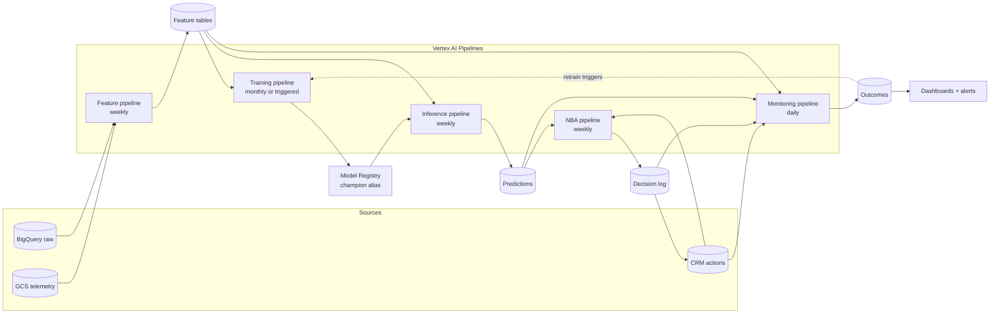
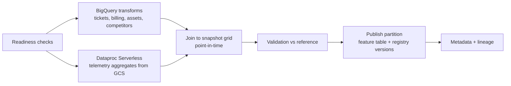
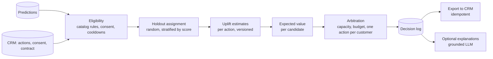

# SMB Broadband Churn Prediction and Next Best Action: Design Document

> Status: Draft for design review
> Platform: Google Cloud (BigQuery, Cloud Storage, Vertex AI Pipelines, Model Registry, Cloud Monitoring)
> Note: Table names, thresholds, costs, and window sizes are placeholders. Replace them with measured values from your data before use.

---

## 0. Overview

### 0.1 What this system does

1. Every week, it predicts which SMB broadband customers are likely to leave within the next 90 days, as a calibrated probability.
2. For each customer, it decides whether to act and which retention action gives the best expected value, including the option to do nothing.
3. It measures whether those actions actually kept customers, using a holdout group, and feeds the results back into the models.

### 0.2 Why a prediction alone is not enough

A churn score answers "who might leave?" The retention team needs "what should we do, for whom, and did it work?" Most of the business value, and most of the risk, lives after the prediction:

- Acting on every high score wastes money on customers who would have stayed or who cannot be saved.
- Contacting some customers about retention makes them more likely to leave.
- Without a control group, nobody can prove the program saved anyone.

This document covers the full chain: data, prediction, decision, action, outcome, and learning.

### 0.3 Design principles

- **Point-in-time correctness.** Every feature and label is computed as of a snapshot date using only data available then. This rule is enforced by automated tests, not by convention.
- **Calibrated probabilities.** Scores are real probabilities, because the decision layer multiplies them by money.
- **Decisions in code, not in models.** The next-best-action choice is a deterministic, versioned rule over model outputs, costs, and constraints.
- **Measure incrementally.** A random holdout exists in every cycle. Success is churn avoided compared with the holdout, not the number of contacts made.
- **Everything is versioned and traceable.** A prediction can be traced to its data, features, model, calibrator, and decision rule.
- **Promotion is gated.** No model or rule reaches production without passing an evaluation against the current champion and a recorded approval.

### 0.4 Success metrics

| Layer | Metric | Why it matters |
|---|---|---|
| Model ranking | PR-AUC; recall at the top-k the team can contact | Accuracy is meaningless at 2% churn |
| Model calibration | Brier score vs base-rate baseline; reliability curve | Decisions use the probabilities directly |
| Model stability | PSI on features and scores between periods | Early warning of drift |
| NBA | Incremental retention: churn(holdout) − churn(treated), × customer value, − cost | The only proof the program works |
| Operations | Pipeline success rate, time to score, cost per run | Reliability of the weekly cycle |
| Adoption | Share of recommendations acted on; override rate with reasons | Trust from the retention team |

### 0.5 Glossary

- **Snapshot date:** the date "as of" which a customer's features are computed and from which the 90-day label window starts.
- **Label window / horizon:** the 90 days after a snapshot in which churn is observed.
- **OOT (out of time):** evaluation data from a period after all training, calibration, and test data.
- **Calibration:** adjusting scores so that a score of 0.30 means about 30% of such customers churn.
- **Uplift:** the change in churn probability caused by an action, compared with doing nothing.
- **Holdout:** eligible customers randomly left untreated, used as the comparison group.
- **Champion / challenger:** the model currently serving, and a candidate that must beat it before promotion.
- **PSI (population stability index):** a measure of how much a distribution has shifted between two periods.

---

# Part A: Development

## 1. Data sources and contracts

### 1.1 Sources

| Source | Where | Grain | Used for |
|---|---|---|---|
| Customer master | BigQuery | one row per customer | population, segments, tenure, size |
| Broadband assets | BigQuery | one row per asset with activation and cease dates | churn label, asset counts |
| Network telemetry | GCS (Parquet) | per asset per day | utilization, outages, speed degradation |
| Service tickets | BigQuery | one row per ticket | ticket velocity, resolution times |
| Billing and revenue | BigQuery | per account per month | revenue trends, late payments |
| Competitor footprint | BigQuery | per location per period | competitive exposure |
| Customer text (surveys, call notes) | GCS or BigQuery | per interaction | sentiment |
| Retention actions | CRM export into BigQuery | per action with timestamp | NBA uplift estimation, backtests, outcomes |

### 1.2 Data contracts

Each source gets a short contract, stored in the repository and checked by the pipeline:

```yaml
# contracts/tickets.yaml
table: telecom_raw.tickets
grain: one row per ticket
keys: [ticket_id]
required_columns:
  customer_id: STRING
  created_at: TIMESTAMP
  resolved_at: TIMESTAMP   # nullable
  category: STRING
freshness: data for day D must be present by D+1 06:00 UTC
partitioned_by: DATE(created_at)
known_issues:
  - category was renamed in 2024-03; mapping in transforms/ticket_category_map.yaml
owner: service-operations-data-team
```

The contract check runs as the first component of every pipeline. If a required column is missing or the latest partition is older than the freshness rule, the pipeline fails with a clear message before any transformation starts.

### 1.3 The customer timeline

All sources are normalized into one event table keyed by customer ID and event timestamp before any feature is built. This is the foundation of point-in-time correctness: every later step filters this table by `event_ts <= snapshot_date`.

```
customer_events(customer_id, event_ts, event_type, asset_id, payload JSON, source, ingested_at)
```

`ingested_at` matters. If a ticket created on day 10 only arrived in the warehouse on day 14, a model scoring on day 12 could not have seen it. For strict correctness, features use `ingested_at <= snapshot_date` where that field exists. If it does not, document the lag and assume features are computed with a buffer.

---

## 2. Problem framing

### 2.1 Churn definition

A customer is churned when **all** of their broadband assets have ceased. If one asset remains active, the customer is not churned. Cease reasons (competitor, experience, business closure) are kept as attributes so that later analysis can separate avoidable from unavoidable churn, but the label includes all causes unless the business decides otherwise.

Edge cases to decide and document:

- **Returning customers:** a customer who reactivates within 30 days of ceasing is treated as not churned (a "grace period") unless the business prefers otherwise.
- **Migrations:** moving an asset to a new product line within the company is not churn.
- **Business closure:** included in the label, but excluded from NBA eligibility, since no action helps.

### 2.2 Horizon

90 days, agreed with the marketing and retention teams. The reasoning: long enough for a retention action to be planned and delivered and for the outcome to appear, short enough that the signals in the data still relate to the outcome. The pipeline treats the horizon as a parameter so that it can be tested, but a change to it requires retraining and re-calibration.

### 2.3 The snapshot grid

Training data is built as one row per customer per snapshot date:

- Snapshot cadence: weekly in production, monthly for training to limit correlated rows (configurable).
- Population at each snapshot: customers with at least one active asset on the snapshot date.
- Label: churned within (snapshot_date, snapshot_date + 90 days].
- Snapshots whose 90-day window is not yet complete are excluded from training, calibration, and testing. They can be scored, but not evaluated.

A customer appears in many snapshots. All of a customer's rows must stay in one split (see section 3), or the model memorizes customers instead of learning patterns.

### 2.4 Exclusions

Document the customers removed before modeling and why, for example accounts in legal dispute, internal test accounts, and accounts already in a cancellation process. The same exclusions apply at inference, so the population matches.

---

## 3. Data splitting

Splits are **by time, then by customer**, never random.

| Split | Period (example) | Purpose |
|---|---|---|
| Train | snapshots in months 1 to 14 | fit the model |
| Calibration | months 15 to 17 | fit the isotonic calibrator |
| Test | months 18 to 19 | tune thresholds, compare candidates |
| OOT | months 20 to 21 | final, untouched evaluation |

Rules:

- Each later split starts after the previous one ends, with a gap of at least the horizon (90 days) between train and calibration label windows so that no label period overlaps.
- A customer's rows never cross splits. If this is impossible because every customer exists in every period, assign customers to splits by a hash of customer ID in addition to time, and accept a smaller dataset.
- Record the number of churn events in each split. With 2% prevalence, a split with fewer than a few hundred churners gives unstable metrics, and the calibration split in particular needs enough positives per bin.

---

## 4. Feature engineering

### 4.1 Feature families

| Family | Example features | Window | Source |
|---|---|---|---|
| Account | tenure months, number of assets, plan tier, contract end in next 30/60/90 days, customer size | as of snapshot | customer master, assets |
| Service experience | tickets in 30/90 days, ticket velocity ratio (30d / 90d), mean resolution hours, repeat tickets same category, open ticket count | 30, 90, 180 days | tickets |
| Network | outage minutes, days with degraded speed, utilization percentile, equipment age | 30, 90 days | telemetry |
| Revenue | revenue last 30 days, revenue change vs 90 days earlier, late payments, credits issued | 30, 90, 180 days | billing |
| Competitive | number of competitors at location, new competitor entry in last 90 days, competitor price index | as of snapshot | competitor footprint |
| Sentiment | latest sentiment score, negative interactions in 90 days | 90 days | customer text |
| Engagement | logins, usage trend, portal visits | 30, 90 days | product telemetry |
| History | prior churn warnings, prior retention actions and their outcome | all time | actions |

Contract end dates deserve attention: in B2B broadband, many cancellations cluster at contract expiry, so "days until contract end" is often among the strongest features and is also the clearest trigger for a renewal action.

### 4.2 Point-in-time computation

Every feature is a function of (customer, snapshot_date) that reads only rows with `event_ts <= snapshot_date`. The reference implementation in BigQuery SQL:

```sql
-- Ticket features, point in time. One row per (customer_id, snapshot_date).
WITH grid AS (
  SELECT customer_id, snapshot_date
  FROM `proj.churn_features.snapshot_grid`
  WHERE snapshot_date BETWEEN @start AND @end
)
SELECT
  g.customer_id,
  g.snapshot_date,
  COUNTIF(t.created_at BETWEEN TIMESTAMP(DATE_SUB(g.snapshot_date, INTERVAL 30 DAY))
                            AND TIMESTAMP(g.snapshot_date)) AS tickets_30d,
  COUNTIF(t.created_at BETWEEN TIMESTAMP(DATE_SUB(g.snapshot_date, INTERVAL 90 DAY))
                            AND TIMESTAMP(g.snapshot_date)) AS tickets_90d,
  AVG(IF(t.resolved_at IS NOT NULL AND t.resolved_at <= TIMESTAMP(g.snapshot_date),
         TIMESTAMP_DIFF(t.resolved_at, t.created_at, HOUR), NULL)) AS mean_resolution_hours_90d
FROM grid g
LEFT JOIN `proj.telecom_raw.tickets` t
  ON t.customer_id = g.customer_id
 AND t.created_at <= TIMESTAMP(g.snapshot_date)
 AND t.created_at >= TIMESTAMP(DATE_SUB(g.snapshot_date, INTERVAL 180 DAY))
GROUP BY 1, 2
```

Note the resolution-time feature: a ticket resolved after the snapshot date is treated as unresolved. Forgetting this is a common leak.

### 4.3 Leakage tests (automated)

These run in CI on a sample and in the pipeline on every build:

1. **Timestamp test:** for every feature with a traceable source timestamp, assert `max(source_ts) <= snapshot_date`.
2. **Future-shift test:** recompute features with the snapshot shifted 30 days earlier; a feature that changes by using later events fails.
3. **Suspicious-strength test:** any single feature with univariate AUC above a threshold (for example 0.95) is flagged for manual review, since real churn signals are rarely that clean.
4. **Consequence test:** features derived from events that typically follow a cancellation decision (cancellation request tickets, final bills, equipment return) are blocked by name in a deny list.

### 4.4 Feature registry

Each feature has an entry with name, definition (SQL or Spark reference), family, window, owner, version, and the date it entered production. The registry is a YAML file in the repository and a table in BigQuery, generated from the same source. Changing a feature definition bumps its version; the model records which feature versions it was trained on.

### 4.5 Where features are stored

- **BigQuery feature tables**, partitioned by snapshot date and clustered by customer ID, are the system of record. They support point-in-time reads, backfills, and audits.
- **GCS** holds Spark intermediates and large telemetry aggregates.
- **Vertex AI Feature Store** is optional, and only needed if a real-time endpoint must read features with low latency. For weekly batch scoring, BigQuery is sufficient and simpler.

---

## 5. Feature selection

1. **Coverage and quality:** drop features that are null for most customers or constant.
2. **Stability:** compute PSI for each feature between the first and last training quarter. Features with PSI above 0.25 are removed or redefined; between 0.1 and 0.25 they are flagged.
3. **Consequence review:** the top 30 features by importance are reviewed with the retention team to confirm each one is a cause or an early sign, not a consequence of leaving.
4. **Redundancy:** among highly correlated pairs (|r| > 0.9), keep the one that is more stable and easier to explain.
5. **Model-based selection:** train with all remaining features, compute SHAP importance on the test split, and remove features with negligible contribution, re-checking OOT performance after removal.
6. **Business explainability:** the final set must be explainable to the retention team, because SHAP reasons will be shown to them.

Record the selection decisions and the before/after metrics in the experiment tracker.

---

## 6. Model training

### 6.1 Baselines first

Before the gradient-boosted model, train and record:

- A constant-rate baseline (predicts the base rate), which sets the Brier floor.
- A logistic regression on 10 to 15 strong features, which sets a performance floor and a sanity check on the data.

If XGBoost does not beat the logistic baseline by a meaningful margin on OOT, the problem is the data, not the algorithm.

### 6.2 Main model

- **Algorithm:** XGBoost (or LightGBM) for tabular data with mixed feature types and missing values.
- **Imbalance:** `scale_pos_weight` set to negatives/positives, or a milder value chosen on the calibration split. Document the choice: it improves ranking of the rare class but distorts probabilities, which calibration later corrects. Resampling is avoided because it distorts the base rate more.
- **Tuning:** Bayesian or random search over depth, learning rate, subsampling, regularization, and tree count, using early stopping on the calibration split with PR-AUC as the objective. Keep the search bounded and record every trial.
- **Reproducibility:** fixed seeds, pinned versions, recorded training window and feature versions. A re-run of the same commit on the same data must produce the same metrics within tolerance.

### 6.3 Experiment tracking

Every training run logs to Vertex AI Experiments (or MLflow): parameters, feature list and versions, data snapshot range, metrics per split, SHAP summary, model artifact URI, and git commit. The run ID is attached to the model in the registry.

### 6.4 Explainability

SHAP values are computed on the test split for global importance and, at inference, per customer for the top three drivers. The per-customer drivers are stored with the prediction so the retention team sees why a customer scored high, and so the NBA layer can use them to pick candidate actions.

---

## 7. Calibration

### 7.1 Why

The decision layer computes expected value = probability × money. A score of 0.30 that really means 15% doubles every expected value. `scale_pos_weight` and boosting both distort probabilities, so calibration is mandatory.

### 7.2 Method selection

Plot the reliability curve of the uncalibrated model on the calibration split (10 to 20 bins by score):

- A smooth, consistent over- or under-confidence suggests **Platt scaling** (two parameters, robust with few positives).
- An irregular, non-monotonic pattern suggests **isotonic regression** (flexible, needs more positives).
- If positives are scarce (fewer than roughly 300 to 500 in the calibration split), prefer Platt or beta calibration, or pool bins and check stability before using isotonic.

Fit the calibrator **only** on the calibration split. Never on training data (overconfident) and never on test or OOT (contaminates evaluation).

### 7.3 Verification

- Brier score before and after calibration on test and OOT, compared with the constant-rate baseline (about 0.0196 at a 2% rate).
- Reliability curve after calibration on OOT; it should sit near the diagonal across the score range the business acts on.
- Expected calibration error (ECE) as a single number for monitoring.
- The calibrator is versioned and stored with the model. Inference always applies both.

---

## 8. Evaluation

### 8.1 Metrics

| Question | Metric |
|---|---|
| Does it rank churners above non-churners? | PR-AUC (primary), ROC-AUC (secondary) |
| How many churners can the team reach? | Precision and recall at top-k, where k is the weekly contact capacity |
| Is the ranking useful across the range? | Decile lift table and cumulative gains |
| Are the probabilities trustworthy? | Brier, ECE, reliability curve |
| Does it generalize forward in time? | All of the above on OOT, compared with test |

Threshold choice for action is **not** F1. It comes from the NBA value calculation, where the cost of a false positive (wasted action) and the value of a true positive (customer kept) are explicit.

### 8.2 Slice analysis

Report metrics by region, plan tier, tenure band, customer size, and contract status. A model that works on average but fails for a segment creates unfair treatment and lost retention in that segment. Slices with materially worse performance are documented in the model card and, if needed, excluded from automated actions until fixed.

### 8.3 Champion comparison

A candidate model is compared with the current champion on the same OOT data and the same metrics. The candidate must meet all of:

- PR-AUC not lower than the champion by more than a small tolerance, and higher on the primary metric.
- Brier on OOT not worse than the champion.
- No slice that gets materially worse.
- Score distribution shift versus the champion within a PSI limit, so the retention team's queues do not change abruptly.

### 8.4 Model card

Each registered model has a card with intended use, population, label definition, training window, feature versions, metrics per split and per slice, known limitations, calibration method, and retraining policy.

---

## 9. Next best action design

### 9.1 The decision problem

For each scored customer, choose one action (or no action) that maximizes expected value, under eligibility rules, contact limits, and budget. The churn probability is the input; the decision is the output.

### 9.2 Action catalog

The catalog is a versioned configuration owned jointly by the retention team and the data team.

```yaml
# nba/actions.yaml (illustrative)
actions:
  - id: priority_engineer_visit
    family: service_recovery
    cost_usd: 150
    capacity_per_week: 60
    eligibility: ["tickets_90d >= 2", "open_ticket_count >= 1"]
    cooldown_days: 60
  - id: account_manager_call
    family: relationship
    cost_usd: 40
    capacity_per_week: 300
    eligibility: ["not do_not_call", "customer_size in ['M','L']"]
    cooldown_days: 30
  - id: renewal_offer
    family: competitive_defense
    cost_usd: 200
    eligibility: ["days_to_contract_end <= 90"]
    cooldown_days: 90
  - id: plan_rightsize
    family: plan_fit
    cost_usd: 20
    eligibility: ["revenue_drop_pct >= 0.2", "plan_tier != 'basic'"]
    cooldown_days: 90
  - id: no_action
    family: none
    cost_usd: 0
```

Start with four to six actions. Too many thins the experiments and slows learning.

### 9.3 Estimating what each action does (uplift)

The churn model predicts the outcome **without** action. Uplift estimates the outcome **with** each action. This cannot come from the churn model; it needs data on customers who received the action and comparable customers who did not.

Approaches, in order of preference:

1. **Randomized experiment data** (a past campaign with a holdout). The cleanest source.
2. **Observational data with adjustment**, when no experiment exists: estimate each customer's propensity to have received the action from pre-action features, then compare treated and untreated customers with similar propensity (matching, inverse-propensity weighting, or doubly robust estimation).
3. **Uplift models** (meta-learners such as T-learner, X-learner, or causal forests, available in CausalML or EconML) trained on the above data, to estimate per-customer uplift rather than one average.

Until there is enough data for per-customer uplift, use per-segment averages with confidence intervals, and be explicit that they are estimates.

Uplift must be estimated with the same point-in-time discipline: features before the action, outcome in the 90 days after it, and the holdout's outcome over the same window.

### 9.4 Value and arbitration

For customer *c* and action *a*:

```
p0        = calibrated churn probability without action
p_a       = p0 − uplift(c, a)           # clipped to [0, 1]
value(c)  = expected margin if the customer is retained (CLV estimate, capped)
EV(c, a)  = (p0 − p_a) × value(c) − cost(a)
EV(c, no_action) = 0
```

Choose the action with the highest EV among eligible actions. If all are negative, choose no action. Customers whose estimated uplift is negative for an action (sleeping dogs) are never given that action.

### 9.5 Constraints across customers

Weekly capacity and budget limits apply across all customers. The simplest robust approach: rank (customer, action) pairs by EV, then greedily assign while respecting per-action capacity and the per-customer rule of one action per cycle. When capacities bind hard, solve a small assignment problem (linear programming) instead.

### 9.6 Contact policy

- Cooldown per action and a global cap on contacts per customer per quarter.
- Do-not-contact and consent flags from the CRM override everything.
- Quiet periods (for example during an active incident on the customer's line).
- Customers in the holdout receive no retention action for the cycle, whatever their EV.

### 9.7 Role of SHAP drivers

Drivers do **not** enter the EV formula. They serve two purposes: narrowing candidate actions (a service-recovery action is a candidate when ticket velocity is a top driver) and explaining the recommendation to the account manager. The estimate of what works comes from uplift, never from the driver alone.

### 9.8 Decision log

Every decision is stored, whether or not an action is taken:

```
nba_decisions(
  decision_id, run_id, scoring_date, customer_id,
  churn_prob, top_drivers ARRAY<STRUCT<feature, contribution>>,
  candidates ARRAY<STRUCT<action_id, eligible, uplift, expected_value, blocked_reason>>,
  chosen_action, holdout_flag, rule_version, model_version, calibrator_version,
  exported_to_crm_at, idempotency_key
)
```

This table is the basis of backtests, monitoring, audits, and the retention team's "why this customer?" questions.

---

## 10. NBA backtest, shadow mode, and pilot

### 10.1 Retrospective backtest (offline policy evaluation)

Purpose: check that the NBA logic is plausible before any live use, using data you already have.

Steps:

1. Choose several past cutoff dates T0, spread across seasons.
2. For each T0, compute features and scores as of T0 using the current model (or a model trained only on data before T0 for strict honesty).
3. Collect actions that occurred in (T0, T0 + 90 days], mapped to the catalog. Actions before T0 are context.
4. Observe churn in the same window.
5. Compare treated and untreated customers **with adjustment for who was chosen**: stratify by churn score decile, or weight by propensity to receive the action. Report confidence intervals.
6. Estimate what the NBA policy would have earned: weight outcomes where the historical action matched the NBA recommendation by the inverse probability of that match (importance sampling), or use a doubly robust estimator. Report the uncertainty; it will be wide when the team rarely did what the NBA would recommend.

Pass criteria, decided **before** running:

- Estimated uplift increases with the NBA's predicted uplift decile (ranking works).
- Predicted uplift is roughly calibrated against observed uplift per bin.
- The NBA does not recommend contact for groups whose observed outcome got worse after contact.
- Results are consistent across cutoff dates.

Limits: the backtest cannot prove causation when assignment was not random. It justifies a pilot; it does not replace one.

### 10.2 Shadow mode

Run the NBA on live weekly scores, write the decision log, but do not act on it. For four to eight weeks, compare recommendations with what the team actually did and measure agreement and the reasons for disagreement. This produces clean, future data and surfaces eligibility and data-mapping problems before anything reaches a customer.

### 10.3 Randomized pilot

For the top two or three recommended actions, randomly assign eligible customers to action or holdout (for example 85/15) for a fixed period. After 90 days, measure incremental retention per action. This is the first causal evidence, and it seeds the uplift models with clean data. The holdout then becomes permanent at a smaller rate (for example 5 to 10%) so the program is always measurable.

---

# Part B: Production

## 11. Platform and environments

### 11.1 Components

| Need | GCP service | Notes |
|---|---|---|
| Orchestration | Vertex AI Pipelines (KFP) | one pipeline per concern: features, training, inference, NBA, monitoring |
| Heavy transforms on GCS data | Dataproc Serverless (PySpark), submitted from a pipeline step | no cluster to manage |
| Tabular transforms | BigQuery SQL from pipeline components | cheaper and more auditable than Spark for tabular joins |
| Feature storage | BigQuery, partitioned by snapshot date | system of record |
| Model storage | Vertex AI Model Registry | versions, aliases, lineage |
| Experiment tracking | Vertex AI Experiments | linked to registry entries |
| Scheduling | Cloud Scheduler → Pipeline trigger (or Cloud Composer if the team already runs Airflow) | weekly cadence |
| Alerts and metrics | Cloud Monitoring, Cloud Logging | alert policies with notification channels |
| Dashboards | Looker Studio on BigQuery | for the retention team and the data team |
| Secrets | Secret Manager | never in code or pipeline parameters |
| Infrastructure as code | Terraform | projects, buckets, datasets, service accounts, IAM |

### 11.2 Environments

Three GCP projects: `churn-dev`, `churn-stage`, `churn-prod`. Each has its own datasets, buckets, registry, and service accounts. No production customer data in dev. Stage holds a masked or sampled copy refreshed on a schedule, so pipelines can be tested on realistic data before promotion.



---

## 12. Code organization

### 12.1 Repository layout

```
churn-nba/
├── README.md
├── pyproject.toml
├── configs/                  # per-environment YAML: project ids, dataset names, horizon, thresholds
├── contracts/                # data contracts per source
├── features/
│   ├── registry.yaml         # feature definitions and versions
│   ├── sql/                  # BigQuery feature queries
│   └── spark/                # PySpark jobs for GCS data
├── src/churn/
│   ├── data/                 # readiness checks, validation, loaders
│   ├── labels/               # churn definition, snapshot grid
│   ├── features/             # feature builders, leakage tests
│   ├── model/                # training, calibration, evaluation, explainability
│   ├── nba/                  # catalog loader, eligibility, uplift, arbitration, decision log
│   ├── monitoring/           # drift, matured-cohort metrics, NBA outcome metrics
│   └── pipelines/            # KFP component and pipeline definitions
├── tests/                    # unit, leakage, pipeline-compile tests
├── notebooks/                # exploration only; never imported by pipelines
├── infra/terraform/
├── deploy/                   # cloudbuild or GitHub Actions configs
└── docs/                     # this document, ADRs, model cards, runbooks
```

### 12.2 Notebook-to-code policy

Vertex AI Workbench notebooks are for exploration. Any logic that will run in a pipeline is moved into `src/churn` with tests before it is used. Notebooks are committed for traceability but are excluded from the package and from CI checks other than a lint that they contain no credentials. This keeps experiments fast and production code reviewable.

### 12.3 Version control rules

- Protected `main` branch; changes through pull requests with at least one reviewer.
- Pre-commit hooks: formatting, lint, secret scan, and a check that no notebook output cells contain data.
- Feature definitions, action catalog, and thresholds are configuration under version control, so a business change is a reviewed commit, not an edit in a console.

---

## 13. CI/CD

### 13.1 Continuous integration (every pull request)

1. Lint and format.
2. Unit tests for labels, features, calibration, NBA arbitration, and monitoring math.
3. Leakage tests on a fixed sample.
4. Compile every pipeline to its JSON spec (catches broken component wiring without running on GCP).
5. Dependency vulnerability scan and secret scan.

### 13.2 Continuous delivery

- Merge to `main` → deploy compiled pipelines and container images to **dev**, run a smoke pipeline on a small sample.
- Tag or manual promotion → deploy to **stage**, run the full pipelines on masked data, run the evaluation gate.
- Approved release → deploy to **prod**. Promotion of a model to the champion alias is a separate, logged approval (section 17).

Authentication from CI to GCP uses workload identity federation. No downloaded service-account keys.

### 13.3 Rollback

Pipelines are versioned artifacts; a rollback redeploys the previous spec. Models roll back by moving the champion alias. Both are documented in the runbooks with expected time to complete.

---

## 14. Data readiness and validation

### 14.1 Readiness checks (first component in every pipeline)

- **BigQuery:** the partition for the snapshot date (or the latest expected date) exists and its row count is within an expected band.
- **GCS:** a completion marker (for example `_SUCCESS`) exists for the expected prefix.
- **CRM actions:** the latest export is not older than the freshness rule.

If a dependency is missing, the component retries with backoff up to N times over a window (for example 6 attempts over 3 hours). After the final failure it raises a Cloud Monitoring alert with the source name and the expected location, and the pipeline stops. Nothing downstream runs on partial data.

### 14.2 Data validation (after transformation)

Checks against a reference profile stored from the last approved run:

- Row counts and distinct customers within tolerance.
- Null rates per column within tolerance.
- Value ranges and category sets.
- Distribution drift per feature (PSI) against the reference; warn at 0.1, fail at 0.25 for critical features.

Validation results are written to a table and shown on the pipeline health dashboard. A validation failure blocks feature publication.

---

## 15. Feature pipeline

Runs weekly, after sources are ready.



Design points:

- The snapshot grid is generated first, so every feature joins to the same population.
- BigQuery handles tabular joins; Spark handles only the telemetry aggregates, which are large and file-based. Spark output lands in GCS, then is loaded to a BigQuery staging table for the join.
- Features are published as a new partition, never overwritten in place. A failed run leaves the previous partition intact.
- The partition carries `feature_set_version` and `run_id` so inference and training can pin to it.
- Backfills reuse the same pipeline with a date range parameter.

Retries, timeouts, and alerting are configured per component, not globally: a Spark step may deserve a longer timeout than a validation step.

---

## 16. Inference pipeline

Runs weekly after the feature pipeline publishes.

1. **Readiness:** the feature partition for the scoring date exists and passed validation.
2. **Model resolution:** load the model and calibrator by the `champion` alias from the Model Registry. The resolved versions are logged.
3. **Schema check:** feature names, types, and versions match what the champion was trained on. A mismatch fails the run; it never silently reorders or fills columns.
4. **Skew check:** compare the scoring batch's feature distributions with the champion's training reference (PSI). Warn or block by threshold.
5. **Score:** raw score → calibrated probability. Compute top-three SHAP drivers per customer.
6. **Write predictions** with full provenance.
7. **Post-checks:** score distribution versus last week (PSI), share of customers above the action threshold, and null drivers. Alert on anomalies.

Prediction table:

```
churn_predictions(
  run_id, scoring_date, customer_id,
  raw_score, churn_prob, score_decile,
  top_drivers ARRAY<STRUCT<feature STRING, contribution FLOAT64>>,
  model_version, calibrator_version, feature_set_version, feature_partition
)
```

---

## 17. Training and retraining pipeline

### 17.1 Triggers

- **Scheduled:** monthly, or quarterly if the data is stable.
- **Drift-triggered:** when feature or score PSI stays above the threshold for two consecutive weeks.
- **Performance-triggered:** when matured-cohort PR-AUC or Brier breaches its tolerance (section 19).
- **Manual:** after a feature or label definition change.

### 17.2 Steps

1. Build or refresh the snapshot grid and labels for the training window (only snapshots whose 90-day window is complete).
2. Assemble the dataset from feature partitions, pinned by version.
3. Time-based split into train, calibration, test, OOT.
4. Train baselines, then the main model with tuning and early stopping.
5. Fit the calibrator on the calibration split.
6. Evaluate on test and OOT, by slice, with SHAP summary.
7. **Evaluation gate:** compare with the champion on the same OOT data using the rules in section 8.3.
8. If the gate passes, register the model and calibrator as a **challenger** with the model card, experiment run, and lineage attached. If it fails, register nothing and post the comparison report.
9. **Promotion** to `champion` is a manual approval step (for example a pipeline step that waits for an approver, or a separate small job run by an approver) and is recorded in the registry and the audit table.

### 17.3 Re-calibration without retraining

If ranking holds (PR-AUC stable) but probabilities drift (Brier or reliability worsens), the pipeline can refit only the calibrator on recent matured data and register a new calibrator version. Cheaper and lower-risk than a full retrain.

### 17.4 Rollback

The previous champion stays in the registry. Rollback is a single alias move, recorded with a reason.

---

## 18. NBA pipeline

Runs weekly after inference.



Design points:

- **Holdout assignment is random and stratified by score decile**, with a fixed seed per run, so the holdout mirrors the treated population. The holdout rate is a configuration value (for example 10% in the pilot, 5% steady state).
- **Uplift estimates are versioned artifacts**, just like the model. The decision log records which version was used.
- **Arbitration is deterministic.** Given the same inputs and rule version, it produces the same decisions.
- **Export is idempotent.** Each decision carries an idempotency key (run ID + customer ID); a re-run cannot create a second contact request.
- **Feedback capture:** the CRM returns which actions were executed, by whom, when, and any override with a reason. This flows back into the decision log and the outcome table.
- **Explanations (optional):** a language model turns the decision record into two plain sentences for the account manager. It receives only the structured record, must cite its fields, and a validator rejects any number or action not present in the record, falling back to a template.

Guardrails that are hard rules in code: no action to do-not-contact customers, no action to holdout customers, no action during an active incident on the customer's service, and no action whose estimated uplift is negative.

---

## 19. Monitoring pipeline

Runs daily. Labels arrive 90 days late, so monitoring has two time horizons: what can be seen now, and what can be confirmed once a cohort matures.

### 19.1 Layers

| Layer | What is measured | Available when | Alert examples |
|---|---|---|---|
| Pipeline health | success, duration, retries, cost per run | immediately | failed run, duration above 2× median |
| Data and features | freshness, validation results, PSI per feature | immediately | PSI > 0.25 on a critical feature |
| Predictions | score distribution PSI, share above threshold, driver distribution | immediately | score PSI > 0.2 or threshold share change > 30% |
| NBA operations | recommendations by action, executed share, override rate, capacity use | within days | executed share < 60%, override rate rising |
| Matured model performance | PR-AUC, Brier, ECE, base rate, decile lift per scoring cohort | 90 days after scoring | PR-AUC drop beyond tolerance, Brier above baseline |
| Matured NBA outcomes | churn in treated vs holdout per action, incremental retention, value − cost | 90 days after action | incremental retention ≤ 0 for an action over two cohorts |
| Fairness | performance and action rates by segment | with each layer | a segment's action rate or outcome diverging |

### 19.2 Matured cohort logic

Each weekly scoring run is a cohort. The monitoring pipeline tracks the cohort's label window and, when it closes, joins predictions and decisions to observed churn and computes the matured metrics. A cohort is evaluated exactly once, and the result is stored in an outcome table so dashboards never recompute history differently.

```
nba_outcomes(
  cohort_scoring_date, customer_id, chosen_action, holdout_flag, executed_flag,
  churn_prob_at_scoring, churned_90d, matured_at, model_version, rule_version
)
```

### 19.3 The 90-day view

The dashboard shows, for the last 90 days of cohorts: predictions made, actions recommended and executed, early proxies (score drift, execution rate), and for cohorts that have matured, the realized churn rates and incremental retention with confidence intervals. The retention team sees the operational view; the data team sees the technical view.

### 19.4 Alerts and runbooks

Every alert policy links to a runbook describing the signal, the first checks, who to call, and the rollback option. Core runbooks: upstream data late, validation failure, score drift, model performance drop on matured cohorts, negative incremental retention for an action, CRM export failure, and cost spike.

---

## 20. Cross-cutting concerns

### 20.1 Lineage and metadata

Vertex ML Metadata (or an equivalent table) records, for every prediction run: data partitions, feature set version, model and calibrator versions, pipeline spec version, and git commit. For every decision: rule version, catalog version, uplift artifact version. Any number on the dashboard can be traced to the code and data that produced it.

### 20.2 Security and privacy

- Dedicated service accounts per pipeline with least-privilege IAM; no default Compute Engine account.
- Column-level security on identifiers and sensitive fields in BigQuery; customer text is stored with access limited to the sentiment job.
- No customer PII in logs, pipeline parameters, or alert messages; use customer IDs and counts.
- Secrets in Secret Manager; CI uses workload identity federation.
- Retention periods for predictions, decisions, and outcomes defined with the privacy team.

### 20.3 Governance

- **Model governance:** model card per version, evaluation gate results, promotion approvals, retraining history.
- **Decision governance:** every NBA decision logged with its reasons; rule and catalog changes reviewed and versioned; override reasons captured.
- **Fairness review:** periodic review of action rates and outcomes by customer segment, with documented decisions when differences are found.
- **Consumer rules:** contact consent and frequency rules enforced in code and reviewed with legal or compliance.

### 20.4 Cost control

- BigQuery: partition pruning on every query, clustering by customer ID, and slot or byte budgets per pipeline.
- Dataproc Serverless only for the telemetry step; everything tabular stays in BigQuery.
- Pipeline caching for unchanged components during development.
- Cost per run tracked on the health dashboard with an alert on a budget threshold.

---

## 21. Core schemas

```sql
-- Snapshot grid with labels (training population)
snapshot_grid(customer_id STRING, snapshot_date DATE, active_assets INT64,
              churn_90d INT64, window_complete BOOL, label_version STRING)

-- Feature table (one partition per snapshot_date)
customer_features(customer_id STRING, snapshot_date DATE, feature_set_version STRING,
                  tickets_30d INT64, tickets_90d INT64, ticket_velocity_ratio FLOAT64,
                  revenue_last_30d FLOAT64, revenue_drop_pct FLOAT64, days_to_contract_end INT64,
                  outage_minutes_30d FLOAT64, competitors_at_location INT64, sentiment_latest FLOAT64,
                  ... , run_id STRING)

-- Predictions, decisions, and outcomes: see sections 16, 9.8, and 19.2

-- Retention actions from CRM (normalized)
retention_actions(action_event_id STRING, customer_id STRING, action_id STRING,
                  requested_at TIMESTAMP, executed_at TIMESTAMP, executed_by STRING,
                  source STRING,  -- 'nba' | 'manual' | 'campaign' | 'dashboard'
                  decision_id STRING,  -- null for non-NBA actions
                  override_reason STRING)
```

---

## 22. Build order and milestones

| Milestone | Deliverable | Exit criteria |
|---|---|---|
| M1 Foundations | repo, contracts, snapshot grid, label code, leakage tests, dev project in Terraform | leakage tests pass on real sample; label counts reviewed with business |
| M2 Features | feature pipeline with readiness and validation; feature registry | weekly partition published in dev for 4 weeks without manual steps |
| M3 Model | training pipeline with baselines, calibration, OOT evaluation, model card, evaluation gate | challenger registered; metrics reviewed; reliability curve acceptable on OOT |
| M4 Scoring and monitoring | inference pipeline, prediction table, drift monitoring, dashboards | weekly scores in stage; alerts tested by injecting drift |
| M5 NBA | action catalog, uplift estimates (segment averages first), arbitration, decision log, backtest | backtest pass criteria met; retention team signs off the catalog |
| M6 Live, measured | shadow mode, then randomized pilot with holdout; outcome monitoring | 90-day incremental retention measured with confidence intervals |
| M7 Steady state | permanent holdout, retraining triggers, uplift models, promotion and rollback drills | one full retrain and one rollback executed through the process |

---

## 23. Open questions to resolve with the business

- What is the retention team's weekly contact capacity by action, and what does each action cost?
- Which actions were taken in the past, where are they logged, and how were customers chosen?
- How is customer value (margin) estimated today, and can it be computed per customer?
- Are there contact-consent or frequency rules that must be enforced beyond do-not-call?
- What holdout rate is acceptable to the business during and after the pilot?
- Which segments require separate treatment or a fairness review?

---

*This document describes a target design. Thresholds and windows should be set from measured baselines, and the design should be reviewed with the retention, data, and compliance teams before implementation.*
